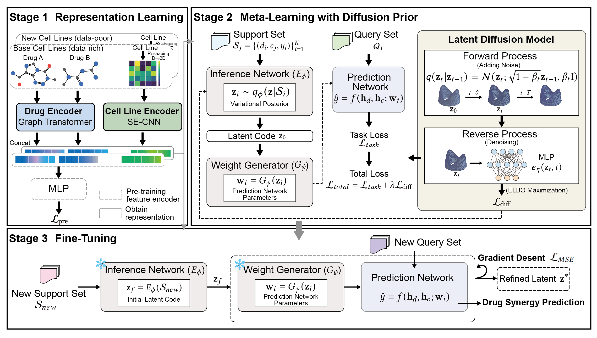

# DiffPro

Implementation of the few-shot regression pipeline from *DiffPro: Decoupled Generative Prior with Diffusion Models for Efficient Few-Shot Drug Synergy Prediction*, published at KDD 2026. [Published paper](https://doi.org/10.1145/3770855.3818930)



*Framework figure from Jin et al., KDD 2026. [Published paper](https://doi.org/10.1145/3770855.3818930)*

## Setup

Run these commands from the repository root. The CPU smoke test used Python 3.12, PyTorch 2.14.0 and PyTorch Geometric 2.6.1. A CUDA GPU is useful for full training.

```bash
python -m venv .venv
source .venv/bin/activate
python -m pip install -r requirements.txt
```

The processed cell-line split and precomputed features are included in `data/`. If you need to restore these files, run `python prepare_data.py` to retrieve and verify them from a pinned HyperSynergy revision. [Data provenance and layout](data/README.md)

## Reproduce the few-shot pipeline

```bash
# 1. Pretrain the drug and cell-line encoders
python pretrain_diffpro.py --epochs 100

# 2. Freeze the encoders and meta-train with the diffusion prior
python train_diffpro.py --steps 40000 --support 5 --query 40 --batch-size 50

# 3. Evaluate held-out cell lines
python evaluate_diffpro.py --support 5
python evaluate_diffpro.py --support 10
python evaluate_diffpro.py --support 30
```

The encoder and model checkpoints are written to `checkpoints/diffpro_encoder.pt` and `checkpoints/diffpro.pt`. Evaluate the new checkpoints after rerunning pretraining from scratch. Test results are written to `results/diffpro_5shot.csv`, `results/diffpro_10shot.csv`, and `results/diffpro_30shot.csv`. Each evaluation round samples 10,000 tasks by default and reports MSE, RMSE, Spearman (SCC), Pearson, and R². Use `--rounds` for repeated evaluation and `--seed` to control sampling.

### Method and defaults

| Stage | Implementation |
| --- | --- |
| Representation pretraining | Supervised Bliss-score regression on base cell lines. The drug encoder uses full attention within each molecule, a learnable bond bias, a feed-forward branch, and sum pooling. The SE-CNN encodes 900 cell-line expression values. |
| Meta-training | Freeze the encoders. Sample a 128-dimensional task latent from the support-set posterior. Use that initial latent for both query MSE and diffusion denoising, following Algorithm 1. The default diffusion schedule uses 50 steps and the denoising loss weight is 0.05. |
| Test-time adaptation | Initialize at the posterior mean and optimize the task latent using support-set MSE, following Algorithm 2. The default is 15 updates. The adaptation step size is configurable and defaults to 0.1 in this implementation. |

Use `--adaptation-steps 0` with a positive `--support` to evaluate the paper's zero-step control. This release covers few-shot regression and that control. The published zero-shot, classification, and conditional diffusion visualization experiments require separate implementations. The release has passed end-to-end smoke checks. A full rerun of the paper's performance tables is pending.

### Shorter CPU run

```bash
python pretrain_diffpro.py --device cpu --epochs 1 --batch-size 32
python train_diffpro.py --device cpu --steps 1 --batch-size 2 --val-batches 1
python evaluate_diffpro.py --device cpu --batch-size 2 --test-batches 1
```

Pretraining still processes the full training split for that epoch. Use these settings to check that all three stages run.

## Citation and acknowledgments

```bibtex
@inproceedings{jin2026diffpro,
  title     = {{DiffPro}: Decoupled Generative Prior with Diffusion Models for
               Efficient Few-Shot Drug Synergy Prediction},
  author    = {Jin, Shuting and Guo, Xu and Huang, Anqi and Xiang, Hongxin and
               Meng, Yajie and Xu, Junlin and Lu, Jiaying and Sun, Xiaobo},
  booktitle = {Proceedings of the 32nd ACM SIGKDD Conference on Knowledge
               Discovery and Data Mining V.2},
  year      = {2026},
  pages     = {11236--11247},
  publisher = {ACM},
  doi       = {10.1145/3770855.3818930}
}
```

DiffPro builds on the HyperSynergy task and hypernetwork framework by Qingqing Zhang, Shaowu Zhang, Yuehua Feng, and Jianyu Shi. The upstream MIT copyright notice is preserved in [LICENSE](LICENSE). [HyperSynergy source](https://github.com/NWPU-903PR/HyperSynergy) · [HyperSynergy paper](https://ieeexplore.ieee.org/abstract/document/10050784/)
